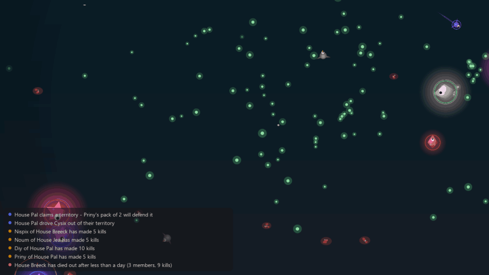
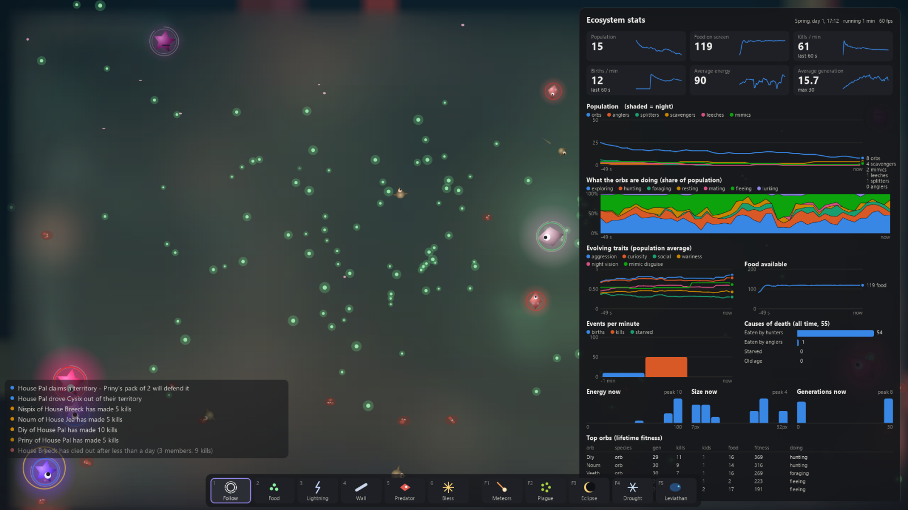
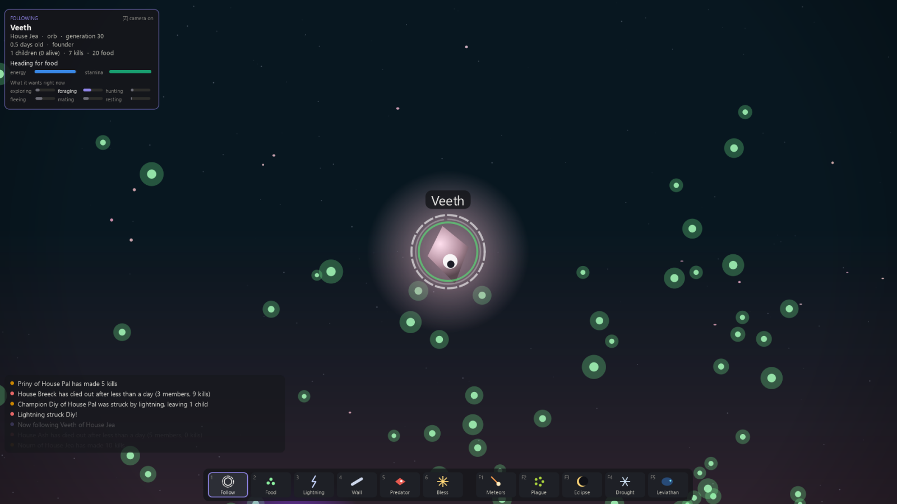
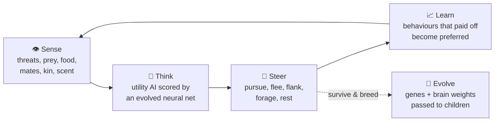

<div align="center">

# 🧠 Intelligent Orbs

**An artificial-life ecosystem that lives on your desktop.**

Dozens of tiny creatures with neural-network brains hunt, flee, forage, form packs, claim territory,
follow scent trails, raise families and evolve, while you watch, or play god.

[](https://github.com/RandomArray/intelligent-orbs/actions/workflows/ci.yml)


[](LICENSE)



</div>

---

## ✨ Highlights

| | |
|---|---|
| 🧠 **Real brains** | Every orb has its own evolved neural network plus a utility AI and lifetime learning. |
| 🐺 **Smart hunting** | Intercept pursuit, stalk-then-pounce, pack flanking, ambushes and scent tracking. |
| 🧬 **Evolution that persists** | The best genomes are saved between runs, so your orbs get smarter every session. |
| 🌗 **Living world** | Day and night, four seasons, weather, migrating food patches and random disasters. |
| 🦠 **Seven species** | Orbs, anglers, splitters, scavengers, leeches, mimics and the occasional leviathan. |
| 🏰 **Stories** | Named orbs, family houses, territories, rivalries and a live event ticker. |
| ⚡ **God mode** | Drop food, call lightning, build walls, summon predators, bless the faithful. |
| 📊 **Stats dashboard** | Population, behaviour, evolving traits, causes of death and a leaderboard. |
| 🪟 **Your desktop is terrain** | On Windows, open windows become rocks the orbs swim around and hide behind. |

## 🚀 Quick start

Requires Python 3.11+.

```bash
git clone https://github.com/RandomArray/intelligent-orbs.git
cd intelligent-orbs
pip install -r requirements.txt

python intelligent_orbs.py                 # transparent overlay on your desktop
python intelligent_orbs.py --fullscreen    # dark aquarium mode with god tools
python intelligent_orbs.py -f --stats      # full screen with the stats dashboard
```

Right-click the tray icon for every option. In full screen, **Esc** returns to the desktop overlay.

## 📸 Screenshots

<p align="center">
  
  <br><em>Full screen mode with the live stats dashboard and event ticker.</em>
</p>

<p align="center">
  
  <br><em>Click any orb to follow it: its card shows its family, kills and what its brain wants right now.</em>
</p>

## 🦠 The cast

| Species | Role | Signature move |
|---|---|---|
| **Orb** | The main species: hunter or prey depending on size and genes | Pack hunts, alarm calls, territories |
| **Angler** | Ambush predator | Dangles a glowing lure that looks exactly like food |
| **Splitter** | Peaceful grazer | Grows with every meal, then divides in two |
| **Scavenger** | Vulture | Shadows hunters at a safe distance, waiting for leftovers |
| **Leech** | Parasite | Clings to big, sleepy orbs and drains their energy |
| **Mimic** | Harmless grazer in disguise | Dresses up as a dangerous hunter to scare predators off |
| **Leviathan** | World event | A giant that swallows anything it catches; only a brave pack can bring it down |

## 🧠 How an orb thinks



- **Sense:** vision grows with curiosity and shrinks at night. Each orb rates threats (size, aggression, whether
  the other orb is hunting *it*, how fast it is closing in), prey, food, mates, allies, kin and the cursor.
- **Think:** a utility AI scores exploring, foraging, hunting, fleeing, mating and resting. The scores are biased
  by the orb's own neural network (22 inputs → 16 tanh → 8 outputs) and by what has worked for it before.
- **Steer:** Reynolds-style steering: intercept pursuit, stalk-then-pounce, flanking, evasive juking, sliding
  along walls, fleeing toward the herd, flocking and waypoint exploration.
- **Evolve:** traits such as aggression, curiosity, sociability, wariness, night vision and disguise, plus the
  brain weights, are mixed and mutated in each child. Champions go to `orb_genepool.json` and seed the next run
  (delete the file to start evolution over).

## 🎮 Controls

**Tray menu:** pause, speed, full screen, stats, HUD, scent, weather, terrain, events, follow, spawn species,
save the gene pool and quit.

**Full screen keys**

| Key | Action | Key | Action |
|---|---|---|---|
| `Esc` / `F11` | Back to the desktop overlay | `Space` | Pause |
| `[` `]` / `-` `+` / `0` | Slower, faster, 1x | `S` | Stats dashboard |
| `H` | HUD | `E` | Event ticker |
| `C` | Scent heatmap | `W` | Weather |
| `G` | God toolbar | `F` | Drop food at the cursor |
| `N` | Next season | `T` | Skip 6 hours |
| `A` / `R` | Follow the champion / a random orb | `Z` | Follow camera (wheel zooms) |
| `X` | Stop following | Click / right-click | Follow the orb under the mouse |
| `1`–`6` | Tools: follow, food, lightning, wall, predator, bless | `F1`–`F5` | Meteors, plague, eclipse, drought or blizzard, leviathan |

## 🌍 Features in depth

<details>
<summary><b>Alarm calls</b></summary>

An orb that spots a dangerous predator may sound an alarm (yellow ring and "!"). Relatives and very social orbs
within earshot flee from a threat they can't see themselves. Calling costs the caller a little energy but saves
its kin, so evolution decides whether it pays.
</details>

<details>
<summary><b>Anglers</b></summary>

Rare, dark, slow orbs that sit perfectly still dangling a glowing lure that looks exactly like food. Hungry
foragers swim right up to it, and the angler lunges. Anglers set up near food patches or around window corners
and move on if a spot stays empty. Prey fight back through evolution: the **wariness** gene lets an orb see
through the disguise, orbs that notice a lure remember that angler, and alarm calls reveal where it hides.
</details>

<details>
<summary><b>Your windows are terrain (Windows only)</b></summary>

Every visible app window becomes a solid rock. Orbs steer and slide around windows, can't see through them (prey
break line of sight by ducking behind one, and hunters search the last-seen spot), nap on title bars, and get
shoved out when you drag a window over them. Maximised windows are ignored. Toggle it from the tray.
</details>

<details>
<summary><b>Day, night and seasons</b></summary>

A day lasts 2 minutes, a season 3 days and a year 12 days.

- **Night:** vision shrinks, so predators get closer before being noticed. The **night vision** gene trades
  daytime sharpness for seeing in the dark; night-adapted orbs (pale rim) hunt at night and doze by day.
- **Spring:** lush food and a baby boom. **Summer:** steady, with fireflies at night. **Autumn:** less food
  but richer, and falling leaves. **Winter:** scarce food and cold that burns energy; orbs hibernate and snow falls.
- Fertile patches **migrate** each season, and the herds follow them.
</details>

<details>
<summary><b>Full screen mode</b></summary>

Turns the screen into a dark sky that follows the clock and season: slate by day, deep blue with twinkling
stars at night, and a warm glow at dawn and dusk. Your windows are hidden, so they stop being terrain. The
cursor hides after 3 seconds without moving, and the orbs ignore it while it's hidden.
</details>

<details>
<summary><b>Stats dashboard</b></summary>

Tiles with sparklines (population, food, kills and births per minute, energy, generation); population per species
with night shaded; the share of each behaviour over time; evolving traits; food available; events per minute;
causes of death; energy, size and generation distributions; and a top-5 leaderboard. It keeps 30 minutes of
history and draws on a background thread, so it never slows the animation.
</details>

<details>
<summary><b>Names, houses and the event ticker</b></summary>

Every orb has a name and belongs to a house ("Zuka of House Vale"). Children join the house of the more successful
parent, and houses carry over between runs. The ticker reports champions, kill milestones, pack hunts, ambushes,
generation records, houses dying out or returning, and season changes.
</details>

<details>
<summary><b>Follow an orb</b></summary>

Click any orb (or use the tray) to follow it. A card shows its name, house, parents, children and kills, what it's
doing right now ("stalking Pip", "fleeing from Fang", "heading for food... it's Rok's lure!") and bars for what
its brain wants. Press **Z** for a camera that zooms in on it. If your orb dies, the camera passes to its most
successful living child.
</details>

<details>
<summary><b>World events and god tools</b></summary>

Every 1.5–3 in-game days something happens:

- **Meteor shower:** meteors crash in, scattering rich food and flattening anything too close.
- **Plague:** spreads by contact and saps energy. Healthy orbs keep their distance, and survivors become immune.
- **Eclipse:** darkness at midday, so night hunters get a feeding frenzy.
- **Drought / blizzard:** food withers, or wind, cold and snow make it hard to see and stay warm.
- **Leviathan:** a giant drifts across the world. Everyone flees except bold packs of 3 or more, which may attack it.

The full screen toolbar (keys `1`–`6`) lets you sprinkle food, strike lightning, draw temporary walls, summon a
hungry predator, or bless orbs nearby (heal, feed, rest and cure).
</details>

<details>
<summary><b>Splitters, scavengers, leeches and mimics</b></summary>

- **Splitters** never hunt. Every meal makes them bigger, and at their genetic size they divide in two. Crowding
  stops them dividing, so a boom feeds the predators instead of swamping everyone.
- **Scavengers** never kill. They smell remains from far away, shadow predators waiting for leftovers, and breed
  in pairs (or lay an egg alone when well fed). Predators find them stringy.
- **Leeches** home in on big orbs, sleepy ones especially, and drain them. Hosts shake them off by sprinting,
  relatives groom them off, and anyone bigger can eat a leech stuck to a friend.
- **Mimics** look like red hunters up to 1.7x their real size. An evolving **disguise** gene makes them harder to see
  through but costs energy. Predators learn to see through disguises and later forget, so it's an arms race.
</details>

<details>
<summary><b>Territories</b></summary>

Stable hunting packs claim a home range (a tinted circle labelled with their house) that drifts with them. Members
patrol it and charge rival hunters who trespass, and two territorial packs meeting means a border clash.
</details>

<details>
<summary><b>Scent trails</b></summary>

Smells linger on the ground and fade (press **C** to show the heatmap):

- **Food trails (green):** an orb that has just eaten leaves a trail. Hungry orbs that can't see food follow it, ant-style.
- **Body scent (blue):** hungry hunters that can't see prey put their nose down and track it, which is handy at night.
  Anglers and leeches leave no scent.
- **Danger (red):** left at kills, lightning, meteor strikes and alarm calls. Wary orbs steer clear.
</details>

## 🗂️ Project layout

| File | What it is |
|---|---|
| [`intelligent_orbs.py`](intelligent_orbs.py) | The simulation (`World`, the species and the AI) and the PyQt5 overlay |
| [`orb_monitor.py`](orb_monitor.py) | Optional separate monitor window that reads `orb_stats.json` |
| [`launcher.py`](launcher.py) | Menu to start the orbs, the monitor, or both |
| [`smoke_test.py`](smoke_test.py) | Quick headless test of the orb logic |
| [`docs/`](docs) | Screenshots and the demo GIF |

The `World` class runs headless without Qt, which makes it easy to test and benchmark:

```python
from intelligent_orbs import World

world = World(1280, 720)
world.populate()
for _ in range(3000):
    world.step()
print(sum(o.alive for o in world.orbs), "orbs alive")
```

## 🧪 Testing

```bash
python smoke_test.py
```

CI runs the smoke test and a headless ecosystem run on Python 3.11, 3.12 and 3.13.

## 📄 License

[MIT](LICENSE)
